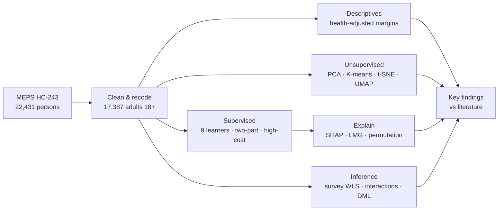
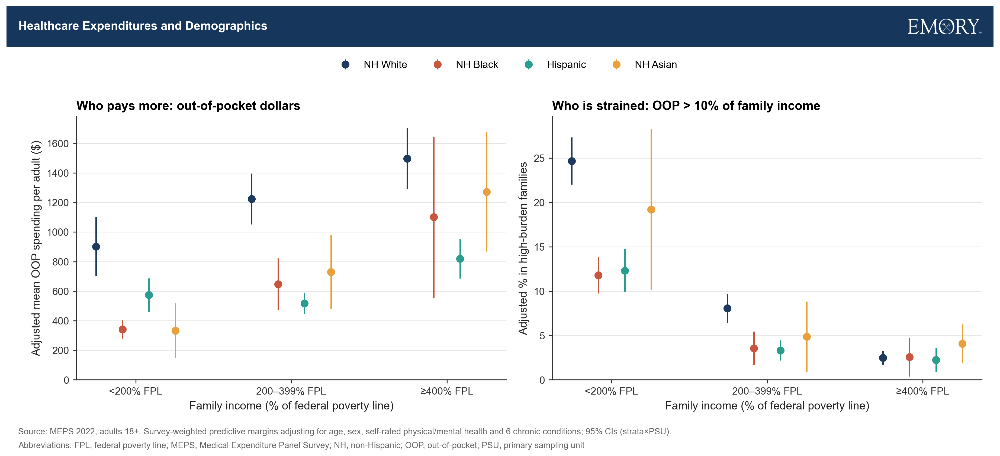
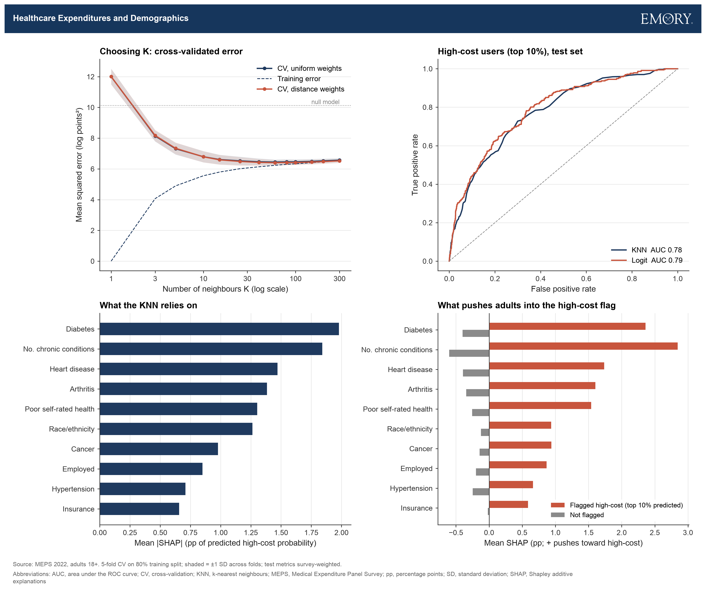
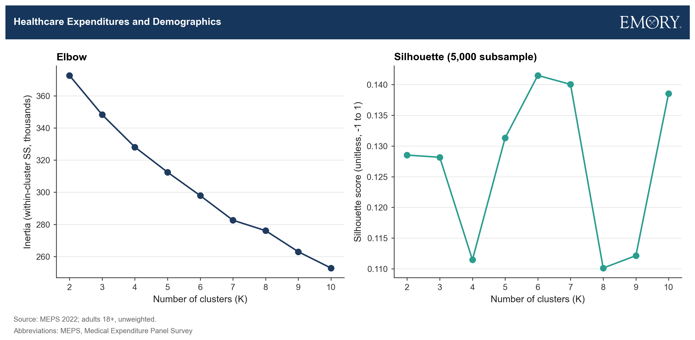
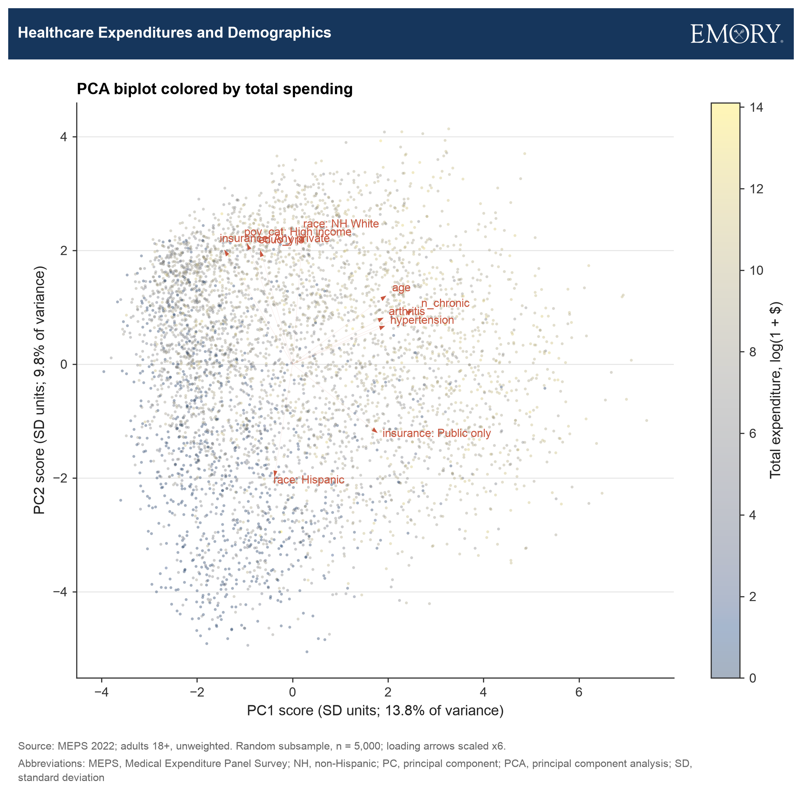
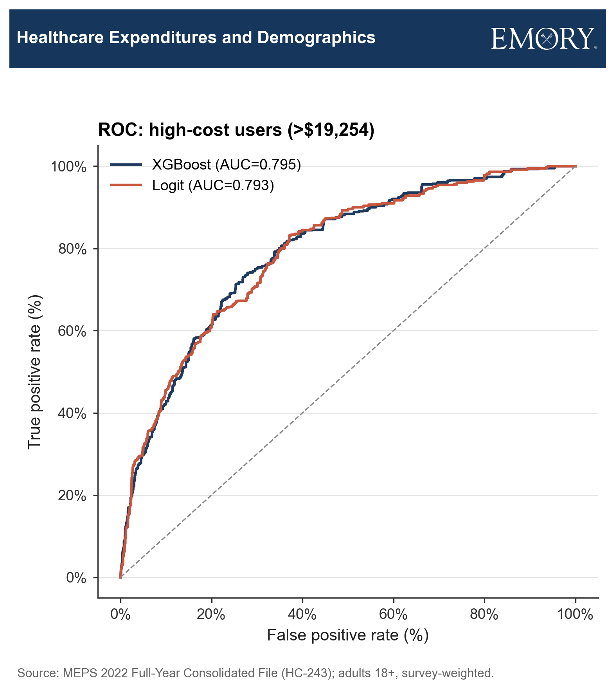
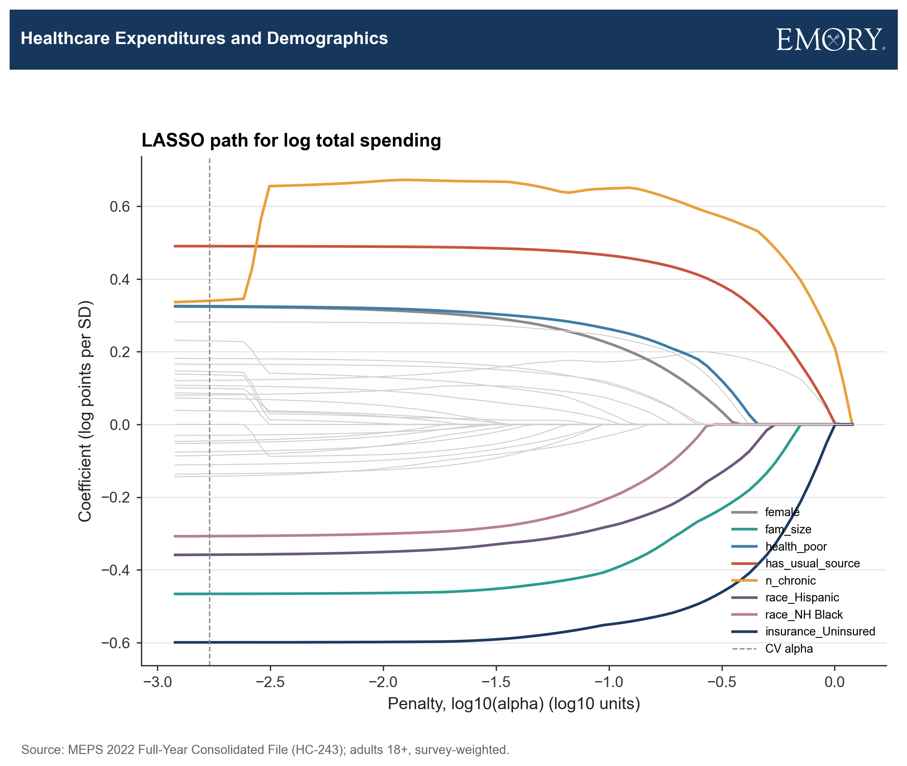
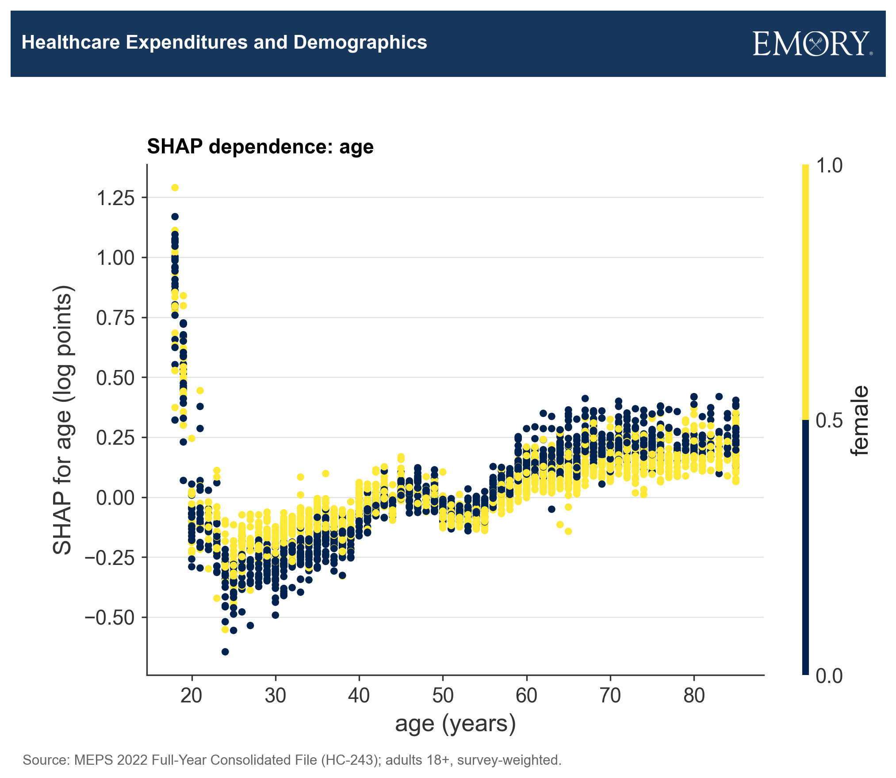
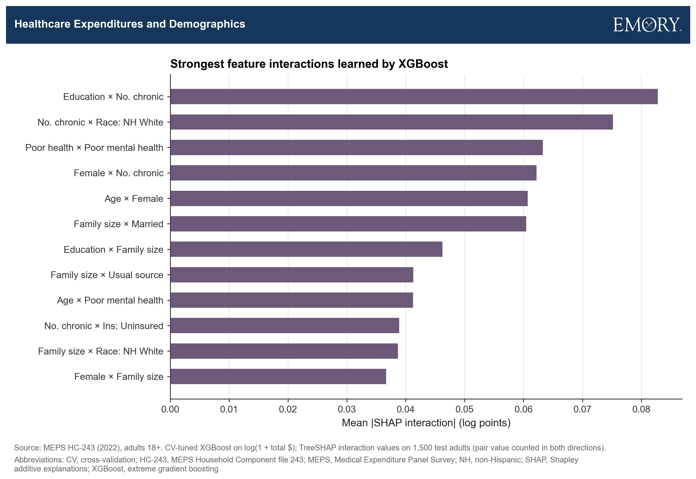

<div align="center">

# Who Spends on Health Care?
### Demographics, Access, and Machine Learning in MEPS 2022

**How do age, sex, race, income and access to care relate to what U.S. adults spend on health care — once health itself is held fixed?**


-012169)


**Eshan Momin · Zach Etizioni · Amulya Arora**

*ECON 442 · Machine Learning for Economics · Emory University · Fall 2026*

</div>

---

## 📌 Results at a glance

<table>
<tr>
<td align="center" width="25%"><h2>$7,762</h2>mean annual spending<br/>per adult (2022)</td>
<td align="center" width="25%"><h2>47%</h2>of all spending comes<br/>from the top 5% of adults</td>
<td align="center" width="25%"><h2>−52%</h2>Black–White spending gap,<br/>fully adjusted</td>
<td align="center" width="25%"><h2>R² 0.39</h2>best test fit (gradient boosting);<br/>OLS gets 0.37</td>
</tr>
</table>


| # | Finding | Evidence |
|:-:|---|---|
| 1 | **Spending is extremely concentrated** | Top 5% → **47%** of spending (AHRQ benchmark: 48–51%) |
| 2 | **The age gradient is mostly health** | 65+ vs 18–34: **3.0×** unadjusted → **1.2×** health-adjusted ($8.5k vs $7.2k) |
| 3 | **Race gaps survive full adjustment** | vs NH White, holding health, SES & access fixed: NH Black **−52%**, Hispanic **−54%**, NH Asian **−37%** |
| 4 | **Low spending ≠ low strain** | Below 200% FPL, **25%** of White vs **12%** of Black/Hispanic adults face OOP burden >10% of income |
| 5 | **Medicare narrows the gaps** | Black–White gap **−66%** (18–34) → **−32%** (65+); age × race p < 0.001, while income and insurance moderators are n.s. |
| 6 | **Access predicts like illness** | Usual source of care is the **#2 SHAP feature**; being uninsured has the largest negative effect |
| 7 | **Demographics + SES get ~60% of the way** | Test R² **0.24** (demographics + SES) vs **0.39** (+ access & health), consistent across 9 learners |
| 8 | **Flexible ML adds little over OLS** | 0.391 (GBM) vs 0.372 (OLS), matching Buntin & Zaslavsky (2004) and Rose (2016) |

> ⚠️ Cross-sectional data: every estimate is a **conditional association, not a causal effect**.

---

## 🧭 The pipeline




### ① Data & sample
| | |
|---|---|
| **Source** | AHRQ **MEPS Household Component, 2022 Full-Year Consolidated File (HC-243)** |
| **Sample** | Adults 18+ with a positive person weight — **17,387** |
| **Outcomes** | Total spending (`TOTEXP22`), out-of-pocket (`TOTSLF22`), any spending, top-10% high-cost user, family OOP burden > 10% of income |
| **Survey design** | Person weights (`PERWT22F`), strata (`VARSTR`), PSUs (`VARPSU`) in every estimate |
| **Health controls** | Self-rated physical & mental health + six diagnoses (diabetes, hypertension, heart disease, asthma, arthritis, cancer) |

Script: [`01_prepare_data.py`](code/01_prepare_data.py)

### ② Descriptives — *who spends more?*
<table><tr>
<td width="50%"><br/><sub><b>Fig 2.</b> Health-adjusted means (bars) vs raw means (diamonds).</sub></td>
<td width="50%"><br/><sub><b>Fig 3.</b> Share of explained variance by domain: LMG (linear) vs SHAP (XGBoost).</sub></td>
</tr></table>


<sub><b>Fig 4.</b> Adjusted % differences in total spending from one survey-weighted model with every factor included.</sub>

Scripts: [`02_descriptives.py`](code/02_descriptives.py) · [`margins.py`](code/margins.py) · [`12_drivers.py`](code/12_drivers.py)

### ③ Race, income & out-of-pocket burden
<table><tr>
<td width="50%"><br/><sub><b>Fig 5.</b> Who pays more vs who is strained, by race × income.</sub></td>
<td width="50%"><br/><sub><b>Fig 6.</b> Race gaps as controls are layered in.</sub></td>
</tr></table>


<sub><b>Fig 7.</b> Race × age and race × sex interactions — gaps narrow sharply at Medicare age.</sub>

Scripts: [`08_focused_oop.py`](code/08_focused_oop.py) · [`14_interactions.py`](code/14_interactions.py)

### ④ Unsupervised learning — *population profiles*
<table><tr>
<td width="55%"><br/><sub><b>Fig 8.</b> Seven K-means profiles in PCA, t-SNE and UMAP space (validated against GMM and Ward via ARI).</sub></td>
<td width="45%"><br/><sub><b>Fig 9.</b> Mean spending by profile: $2.9k → $16.5k.</sub></td>
</tr></table>

Script: [`03_unsupervised.py`](code/03_unsupervised.py)

### ⑤ Supervised prediction

<sub><b>Fig 10.</b> Demographics + SES only vs the full feature set, across 9 learners.</sub>

| Model | Test R² (log $) | | Model | Test R² (log $) |
|---|:-:|---|---|:-:|
| Gradient boosting | **0.391** | | OLS | 0.372 |
| XGBoost | 0.390 | | Ridge | 0.372 |
| Random forest | 0.386 | | LASSO | 0.371 |
| MLP | 0.378 | | Elastic Net | 0.371 |

<table><tr>
<td width="50%"><br/><sub><b>Fig 11.</b> KNN: choice of K, high-cost ROC, SHAP drivers.</sub></td>
<td width="50%"><br/><sub><b>Fig 12.</b> Same analysis, demographics + SES only.</sub></td>
</tr></table>

Scripts: [`04_supervised.py`](code/04_supervised.py) · [`06_knn.py`](code/06_knn.py) · [`13_pred_ses_vs_full.py`](code/13_pred_ses_vs_full.py) · [`15_loss_hyperparameter.py`](code/15_loss_hyperparameter.py)

### ⑥ Explainability

<sub><b>Fig 13.</b> SHAP beeswarm for XGBoost — each dot is one adult.</sub>

Script: [`09_shap_main.py`](code/09_shap_main.py)

### ⑦ Inference — Double ML
Partially linear model with repeated 5-fold cross-fitting; LASSO, RF, XGBoost and neural-net nuisance learners; heterogeneity by age.
Scripts: [`05_inference.py`](code/05_inference.py) · [`16_dml_extensions.py`](code/16_dml_extensions.py)

<details>
<summary><b>📂 Supplementary figures</b> (click to expand)</summary>

| | |
|---|---|
|  |  |
| Spending distribution | Model comparison |
|  |  |
| K-means selection | PCA biplot |
|  |  |
| High-cost ROC | LASSO path |
|  |  |
| SHAP dependence: age | SHAP dependence: family income |
|  |  |
| SHAP interaction pairs | OLS coefficients |

</details>

---

## 🧪 Methods summary

| Block | Methods |
|---|---|
| Descriptives | Survey-weighted means, Taylor-linearized SEs, health-adjusted predictive margins |
| Unsupervised | PCA; K-means (elbow + silhouette, K = 7) vs GMM & Ward (ARI); t-SNE, UMAP |
| Supervised | OLS, LASSO, Ridge, Elastic Net, KNN, RF, GBM, XGBoost, MLP; 80/20 split, 5-fold CV; two-part hurdle with Duan smearing; high-cost classifier |
| Explainability | TreeSHAP, permutation SHAP (KNN), SHAP interactions, LMG R² decomposition, permutation importance |
| Inference | Survey WLS with strata × PSU clustered SEs; nested models; race × moderator Wald tests |
| Double ML | Partially linear model, repeated cross-fitting, 4 nuisance learners |
| Loss tuning | \|y − x′θ\|<sup>a</sup> with a chosen by CV (a = 1 LAD ↔ a = 2 OLS) |

Literature comparison with verified citations: [`output/literature_review.md`](output/literature_review.md)

## ▶️ Reproduce

```bash
pip install -r requirements.txt
# data/h243.dta is included (also data/h243.zip); or download HC-243 from meps.ahrq.gov
python code/01_prepare_data.py
for s in 02_descriptives 03_unsupervised 04_supervised 05_inference 06_knn 08_focused_oop 09_shap_main \
         12_drivers 13_pred_ses_vs_full 13b_plot_pred 14_interactions 14b_plot_interactions 00_schematic 10_key_findings; do
  python code/$s.py
done
python code/99_main_figures.py   # collects numbered main figures into output/main_figures/
```
`03_unsupervised.py` takes profile names as a JSON argument (see its header). DML and SHAP-interaction scripts are compute-heavy.

## 🗂 Repository layout
```
code/                 analysis scripts, numbered in run order
  ├─ style.py         shared figure theme
  └─ margins.py       survey-weighted predictive margins
data/                 MEPS HC-243 raw file + cleaned analysis CSV
output/
  ├─ main_figures/    numbered figures used above
  ├─ figures/         supplementary figures
  ├─ tables/          every estimate behind the figures (CSV)
  └─ literature_review.md
```

## ⚠️ Caveats
- Cross-sectional data → conditional associations only. Race is not a manipulable treatment; DML estimates are read descriptively.
- Health controls are coarse (no disability or severity measures).
- Spending is self-reported and AHRQ-imputed; outcomes are modeled as log(1 + $).
