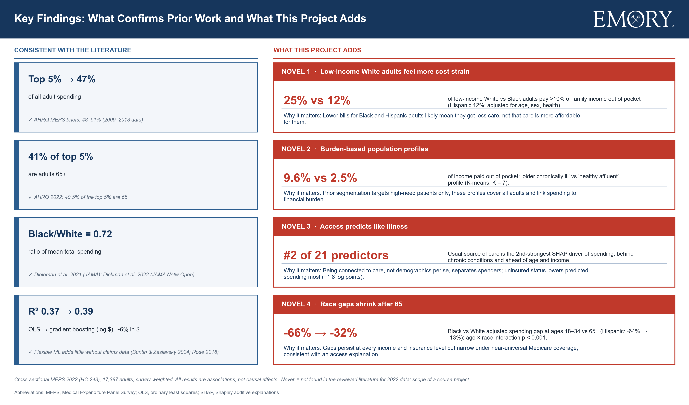
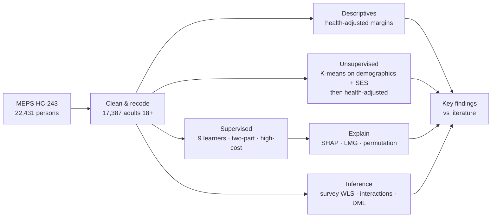
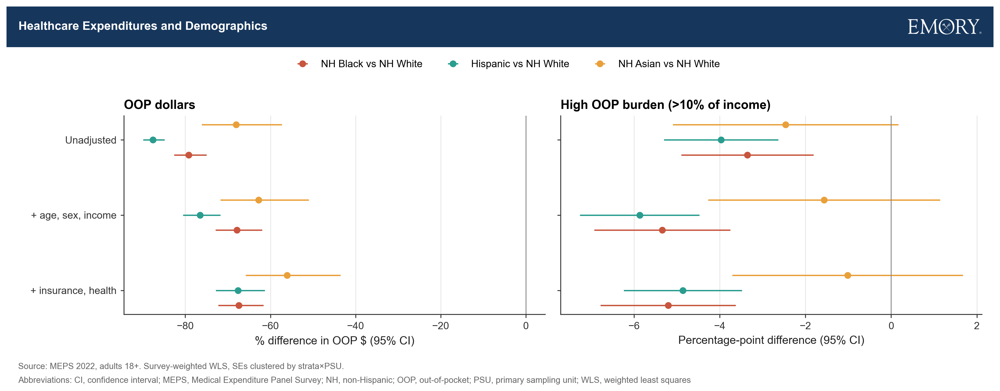
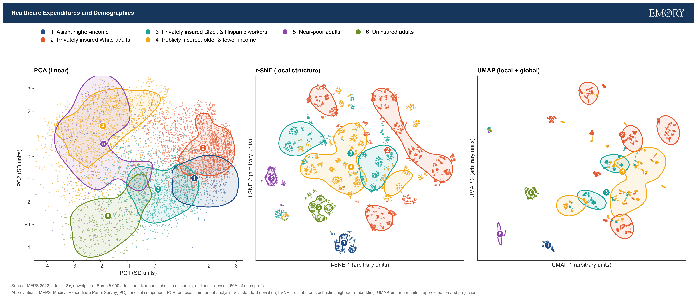
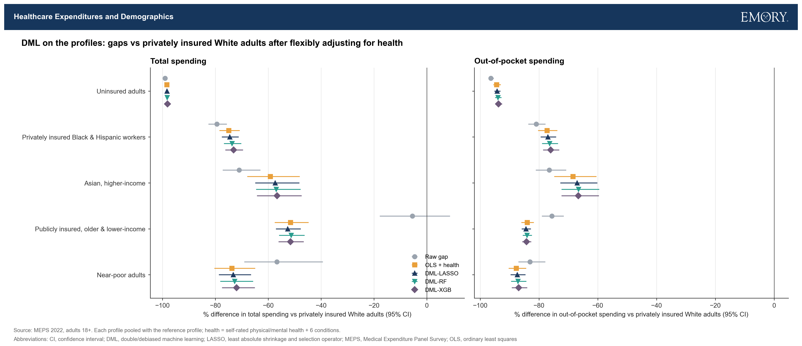
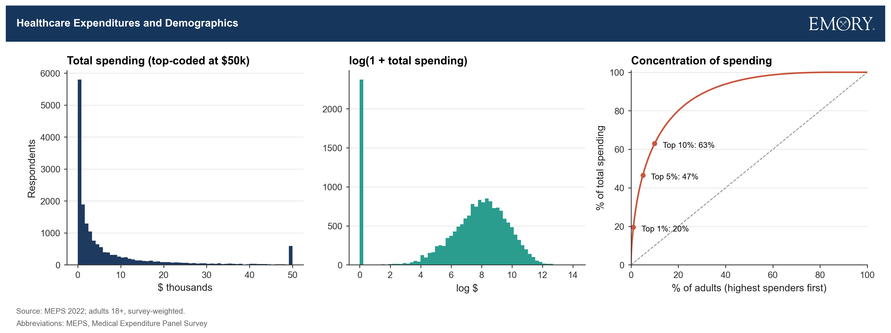
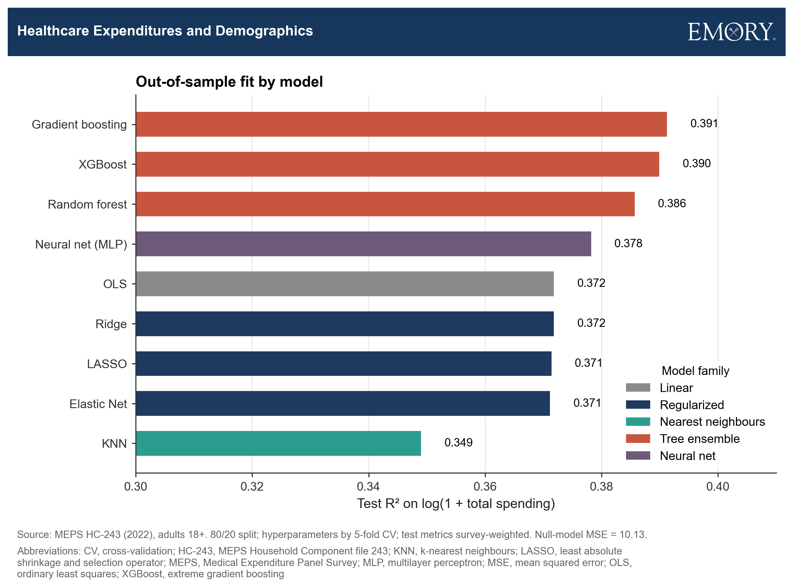
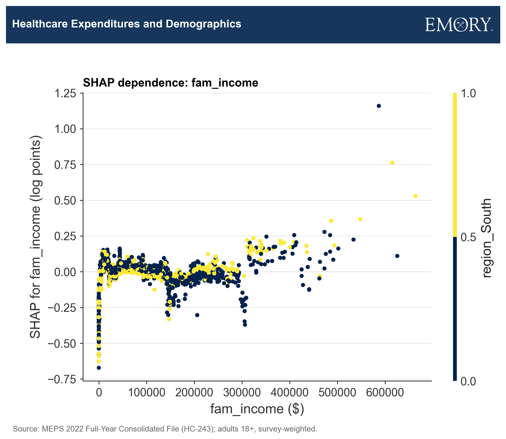
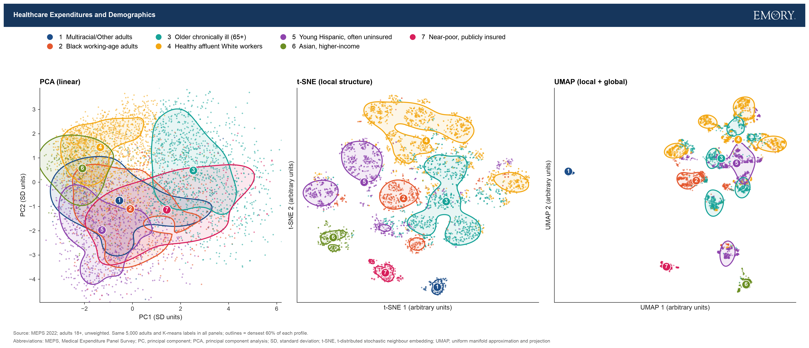
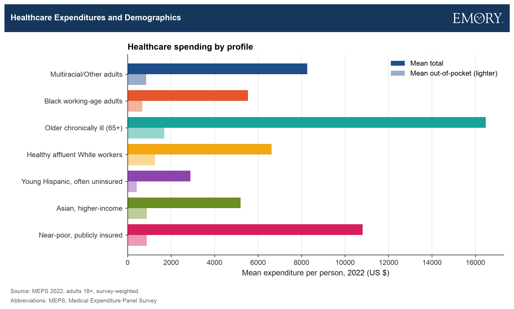

<div align="center">

# Who Spends on Health Care?
### Demographics, Access, and Machine Learning in MEPS 2022

**How do age, sex, race, income and access to care relate to what U.S. adults spend on health care — once health itself is held fixed?**


-012169)


**Eshan Momin · Zach Etizioni · Amulya Arora**

*ECON 442 · Machine Learning for Economics · Emory University · Fall 2026*

</div>

---

**Contents:** [Results](#-results-at-a-glance) · [Pipeline](#-the-pipeline) · [Who spends more](#-who-spends-more) · [Race & burden](#-race-income-and-out-of-pocket-burden) · [Profiles](#-population-profiles-unsupervised-learning) · [Prediction](#-prediction-supervised-learning) · [Explainability](#-what-drives-the-predictions-explainability) · [Methods](#-methods-summary) · [Reproduce](#️-reproduce)

---

## 📌 Results at a glance

<table>
<tr>
<td align="center" width="25%"><h2>$7,762</h2>mean annual spending<br/>per adult (2022)</td>
<td align="center" width="25%"><h2>47%</h2>of all spending comes<br/>from the top 5% of adults</td>
<td align="center" width="25%"><h2>−52%</h2>Black–White spending gap,<br/>fully adjusted</td>
<td align="center" width="25%"><h2>R² 0.39</h2>best test fit (gradient boosting);<br/>OLS gets 0.37</td>
</tr>
</table>

<br/>



<br/>

### Five main findings

1. **Much of the "who spends more" story is really about health.** Adults 65+ spend 3× what 18–34s do, but only **1.2×** at equal health. The publicly insured, older & lower-income profile drops from **$10.4k to $7.1k** once health is held fixed. Spending is also highly concentrated: the top 5% of adults account for **47%** of it.

2. **Race gaps persist even with the same health and coverage.** With health, SES and access held fixed, Black adults spend **52%**, Hispanic adults **54%** and Asian adults **37%** less than White adults. Privately insured Black & Hispanic workers spend **$6.6k** vs **$9.1k** for privately insured White adults at equal health. The gaps narrow sharply at Medicare age (Black–White **−66% → −32%**).

3. **Access to care is the biggest lever after illness.** Having a usual source of care is the **#2 predictor** of spending. Uninsured adults spend **$3.5k** even at equal health, less than half of any insured profile, and only **46%** had any spending at all.

4. **Low spending does not mean low financial strain.** Among low-income adults, **25%** of White vs **12%** of Black/Hispanic adults pay more than 10% of income out of pocket. The publicly insured profile pays **6.4%** of family income out of pocket, twice the share for privately insured White adults (**3.2%**).

5. **Who you are and your access to care predict most of spending, and fancy ML adds little.** Demographics + SES (incl. access) reach test R² **0.33**, about **85%** of the full model's **0.39**. Gradient boosting beats OLS by only 0.02 (0.39 vs 0.37), consistent with prior research.

<sub>Profiles are from K-means (K = 6) on demographics + SES incl. access, with health excluded from clustering; K-means and a Gaussian mixture agree closely (ARI 0.95). The small near-poor profile (3%) is not interpreted.</sub>

> ⚠️ Cross-sectional data: every estimate is a **conditional association, not a causal effect**.

---

## 🧭 The pipeline

*How the analysis moves from raw survey data to findings.*




<br/>

---

## ① Data & sample

| | |
|---|---|
| **Source** | AHRQ **MEPS Household Component, 2022 Full-Year Consolidated File (HC-243)** |
| **Sample** | Adults 18+ with a positive person weight — **17,387** |
| **Outcomes** | Total spending (`TOTEXP22`), out-of-pocket (`TOTSLF22`), any spending, top-10% high-cost user, family OOP burden > 10% of income |
| **Survey design** | Person weights (`PERWT22F`), strata (`VARSTR`), PSUs (`VARPSU`) in every estimate |
| **SES** | Income (% FPL), education, employment **and access to care** (insurance type, usual source of care) |
| **Health** | Self-rated physical & mental health + clinical history: six diagnoses (diabetes, hypertension, heart disease, asthma, arthritis, cancer). Used as an adjustment layer, not as a grouping variable |


<br/>

---

## ② Who spends more?

*Survey-weighted means, with and without adjustment for health.*

<br/>

<p align="center"></p>

> **Fig 2: Most of the "older people spend more" story is really about health.**
>
> Unadjusted, adults 65+ spend about **3×** what adults 18–34 do. After holding health constant (bars), the difference falls to about **1.2×** ($8.5k vs $7.2k). Race gaps barely move after this adjustment.

<br/>

<p align="center"></p>

> **Fig 3: Health explains the most in the linear model, but SES (incl. access) matters as much in XGBoost.**
>
> In the linear (LMG) decomposition, health accounts for **40%** of explained variance, demographics **39%** and SES including access to care **21%** (most of it insurance). In XGBoost's SHAP values the three domains are close: demographics **36%**, SES incl. access **34%**, health **30%**.

<br/>

<p align="center"></p>

> **Fig 4: Race gaps remain even when everything is in the model.**
>
> With health, SES and access held fixed, NH Black adults spend **52%**, Hispanic adults **54%** and NH Asian adults **37%** less than NH White adults. Adults 65+ spend **45%** more than adults 18–34, and the Midwest and West spend about 20–25% more than the South.

<br/>

---

## ③ Race, income and out-of-pocket burden

*Who pays, who is strained, and how the gaps change as controls are added.*

<br/>

<p align="center"></p>

> **Fig 5: Spending less is not the same as being under less financial strain.**
>
> Among low-income adults (below 200% FPL), **25%** of White adults are in families paying more than 10% of income out of pocket, compared with **12%** of Black and Hispanic adults (health-adjusted).

<br/>

<p align="center"></p>

> **Fig 6: Controls shrink the out-of-pocket race gaps but do not close them.**
>
> Adding age, sex, income, insurance and health in turn shrinks the Hispanic–White gap from **−2.09 to −1.13** log points and the Black–White gap from **−1.57 to −1.12**. Both remain highly significant.

<br/>

<p align="center"></p>

> **Fig 7: Race gaps get much smaller at Medicare age.**
>
> The Black–White spending gap is **−66%** at ages 18–34 and **−32%** at 65+. The Hispanic–White gap goes from **−64% to −13%** (age × race interaction p < 0.001). Income and insurance do not significantly change the gaps (p = 0.20 and 0.29).

<br/>

---

## ④ Population profiles (unsupervised learning)

*K-means clustering on **demographics and SES (including access to care) only**. Health status and clinical history are deliberately left out, so the profiles describe who people are; health enters afterwards as an adjustment.*

<br/>

<p align="center"></p>

> **Fig 8: Six demographic and socioeconomic profiles.**
>
> Privately insured White adults (43% of adults), privately insured Black & Hispanic workers (19%), publicly insured older & lower-income adults (21%), Asian higher-income adults (6%), uninsured adults (7%) and near-poor adults (3%). Insurance and income drive the first principal component. K-means and a Gaussian mixture agree almost perfectly (ARI 0.95).

<br/>

<p align="center"></p>

> **Fig 9: Holding health constant changes the ranking, and gaps tied to insurance and race remain.**
>
> Bars are health-adjusted means; black diamonds are unadjusted means. The publicly insured, older & lower-income profile spends the most raw (**$10.4k**), but this falls to **$7.1k** once health is held fixed, so its high spending is mostly about being sicker. Privately insured White adults spend about the same either way (**$8.7k → $9.1k**). Privately insured Black & Hispanic workers stay well below them (**$6.6k** adjusted) despite similar coverage. Uninsured adults spend the least by far: **$1.3k** raw and **$3.5k** adjusted, still less than half of any insured profile.

<br/>

---

## ⑤ Prediction (supervised learning)

*Nine learners, 80/20 train-test split, 5-fold cross-validation.*

<br/>

<p align="center"></p>

> **Fig 10: Demographics and SES (including access to care) get about 85% of the way.**
>
> In every learner, test R² is about **0.29–0.33** with demographics and SES (incl. insurance and usual source of care) and about **0.35–0.39** once health status and clinical history are added. Who someone is and their access to care predict most of what the model can explain; health adds the rest.

<br/>

<div align="center">

| Model | Test R² (log $) | &nbsp;&nbsp;&nbsp;&nbsp; | Model | Test R² (log $) |
|---|:-:|---|---|:-:|
| Gradient boosting | **0.391** | | OLS | 0.372 |
| XGBoost | 0.390 | | Ridge | 0.372 |
| Random forest | 0.386 | | LASSO | 0.371 |
| MLP | 0.378 | | Elastic Net | 0.371 |

*Flexible ML models beat OLS by only about 0.02 R², consistent with earlier health-spending research.*

</div>

<br/>

<p align="center"></p>

> **Fig 11: KNN does about as well as OLS.**
>
> Cross-validation selects **K = 60** (distance-weighted), with test R² **0.35** vs **0.37** for OLS. Chronic conditions and access drive its high-cost predictions.

<br/>

<p align="center"></p>

> **Fig 12: Without health information, race, employment and insurance drive the predictions.**
>
> When KNN sees only demographics and SES (incl. access), race/ethnicity, employment, insurance, age and income (% FPL) are the main features behind high-cost predictions (AUC **0.71**).

<br/>

---

## ⑥ What drives the predictions? (explainability)

*SHAP values from the XGBoost model.*

<br/>

<p align="center"></p>

> **Fig 13: Access to care predicts spending about as strongly as illness does.**
>
> The number of chronic conditions is the top predictor, and having a usual source of care is a close second. Larger families predict lower spending per person. Being uninsured pushes predicted spending down the most.

<br/>

---

## ⑦ Inference: Double ML on the profiles

*Does each profile's spending gap survive when health is adjusted for as flexibly as machine learning allows?*

Double ML (DML) first uses an ML model to remove everything health can explain from both spending and profile membership. It then measures the gap in what is left. Cross-fitting (5 folds × 3 repeats) keeps the estimates honest and gives valid confidence intervals. Each profile is compared with privately insured White adults, using LASSO, random forest and XGBoost in turn.

<br/>

<p align="center"></p>

> **Fig 14: The profile gaps hold up under flexible health adjustment. DML lands almost exactly on the simple linear adjustment.**
>
> All three ML learners agree with each other and with OLS within a few percentage points, so the gaps are not an artifact of modelling health too simply.
> - **Uninsured adults:** about **−98%** in total and **−94%** in out-of-pocket spending, and **45 pp** less likely to use any care, whichever method is used.
> - **Privately insured Black & Hispanic workers:** **−79%** raw → **−75%** OLS → **−73 to −75%** DML. Health explains almost none of the gap.
> - **Publicly insured, older & lower-income:** the raw gap is near zero (**−5%**) but becomes **about −52%** once health is held fixed. This group is much sicker, and at equal health it uses far less care.
> - **Asian, higher-income:** **−71%** raw → **about −57%** after adjustment.

<sub>These are gaps in log(1 + $), roughly typical (geometric-mean) spending, so they are much larger than the gaps in mean dollars in Fig 9. Many adults have zero or low spending, and a few very high spenders pull the mean up. DML is unweighted; raw and OLS gaps are unweighted with SEs clustered by strata × PSU. The near-poor profile is not interpreted. These are associations, not causal effects.</sub>

<br/>

<details>
<summary><b>📂 Supplementary figures</b> (click to expand)</summary>

| | |
|---|---|
|  |  |
| Spending distribution | Model comparison |
|  |  |
| K-means selection | PCA biplot |
|  |  |
| High-cost ROC | LASSO path |
|  |  |
| SHAP dependence: age | SHAP dependence: family income |
|  |  |
| SHAP interaction pairs | OLS coefficients |
|  |  |
| Robustness: profiles when health *is* included in clustering (K = 7) | Robustness: spending by those health-inclusive profiles |

</details>

<br/>

---

## 🧪 Methods summary

| Block | Methods |
|---|---|
| Descriptives | Survey-weighted means, Taylor-linearized SEs, health-adjusted predictive margins |
| Unsupervised | PCA; K-means on demographics + SES incl. access (silhouette, K = 6) vs GMM & Ward (ARI); t-SNE, UMAP; raw vs health-adjusted profile spending |
| Supervised | OLS, LASSO, Ridge, Elastic Net, KNN, RF, GBM, XGBoost, MLP; 80/20 split, 5-fold CV; two-part hurdle with Duan smearing; high-cost classifier |
| Explainability | TreeSHAP, permutation SHAP (KNN), SHAP interactions, LMG R² decomposition, permutation importance |
| Inference | Survey WLS with strata × PSU clustered SEs; nested models; race × moderator Wald tests |
| Double ML | Partially linear model on profile vs reference, health as flexible controls; 5-fold cross-fitting × 3 repeats; LASSO, RF, XGBoost |
| Loss tuning | \|y − x′θ\|<sup>a</sup> with a chosen by CV (a = 1 LAD ↔ a = 2 OLS) |

Literature comparison with verified citations: [`output/literature_review.md`](output/literature_review.md)

<br/>

---

## ▶️ Reproduce

```bash
pip install -r requirements.txt
# data/h243.dta is included (also data/h243.zip); or download HC-243 from meps.ahrq.gov
python code/01_prepare_data.py
for s in 02_descriptives 03_unsupervised 04_supervised 05_inference 06_knn 08_focused_oop 09_shap_main \
         12_drivers 13_pred_ses_vs_full 13b_plot_pred 14_interactions 14b_plot_interactions 00_schematic 10_key_findings; do
  python code/$s.py
done
python code/99_main_figures.py   # collects numbered main figures into output/main_figures/
```
`03_unsupervised.py` takes profile names as a JSON argument (see its header). DML and SHAP-interaction scripts are compute-heavy.

<br/>

---

## 🗂 Repository layout
```
code/                 analysis scripts, numbered in run order
  ├─ style.py         shared figure theme
  └─ margins.py       survey-weighted predictive margins
data/                 MEPS HC-243 raw file + cleaned analysis CSV
output/
  ├─ main_figures/    numbered figures used above
  ├─ figures/         supplementary figures
  ├─ tables/          every estimate behind the figures (CSV)
  └─ literature_review.md
```

<br/>

---

## ⚠️ Caveats
- Cross-sectional data → conditional associations only. Race is not a manipulable treatment; DML estimates are read descriptively.
- Health controls are coarse (no disability or severity measures).
- Spending is self-reported and AHRQ-imputed; outcomes are modeled as log(1 + $).
