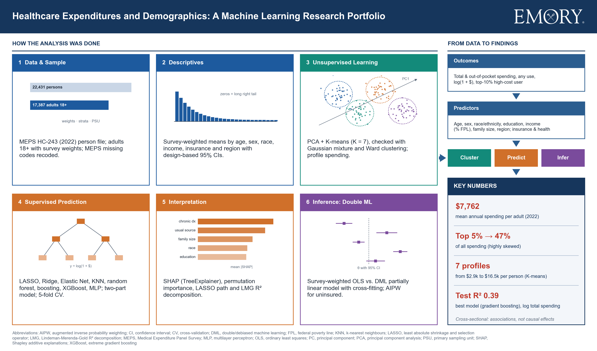
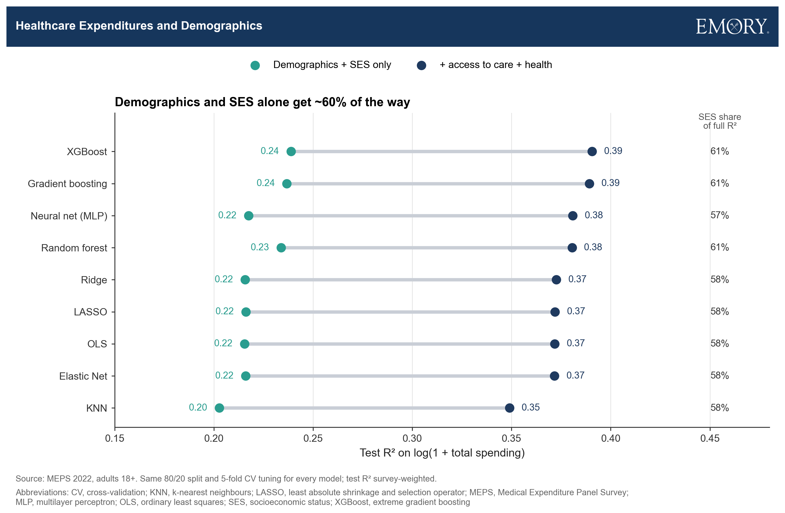
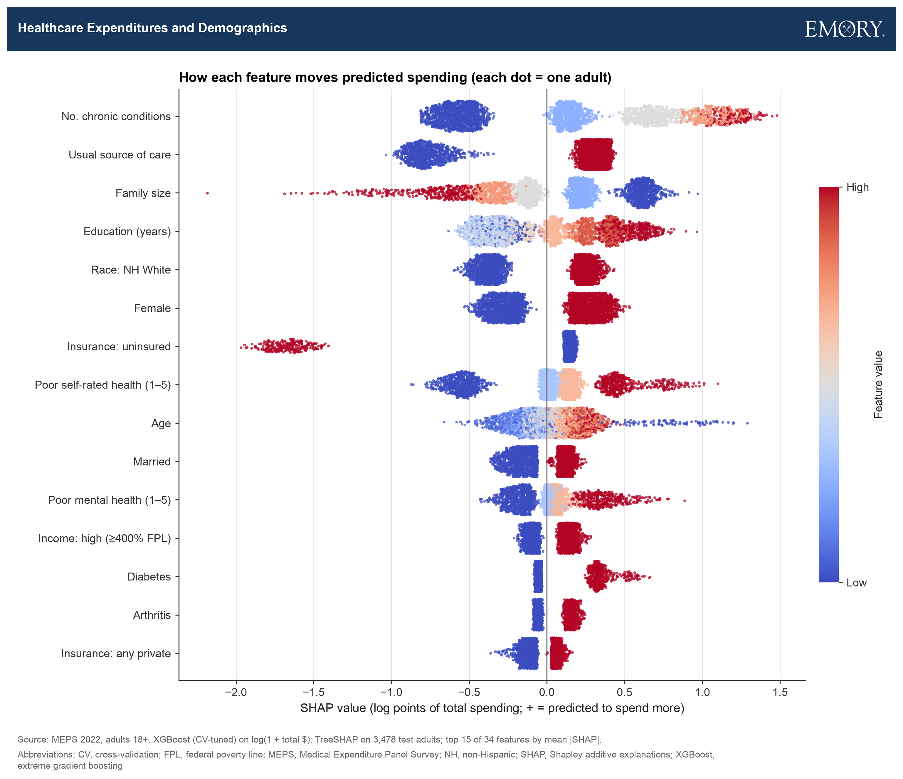
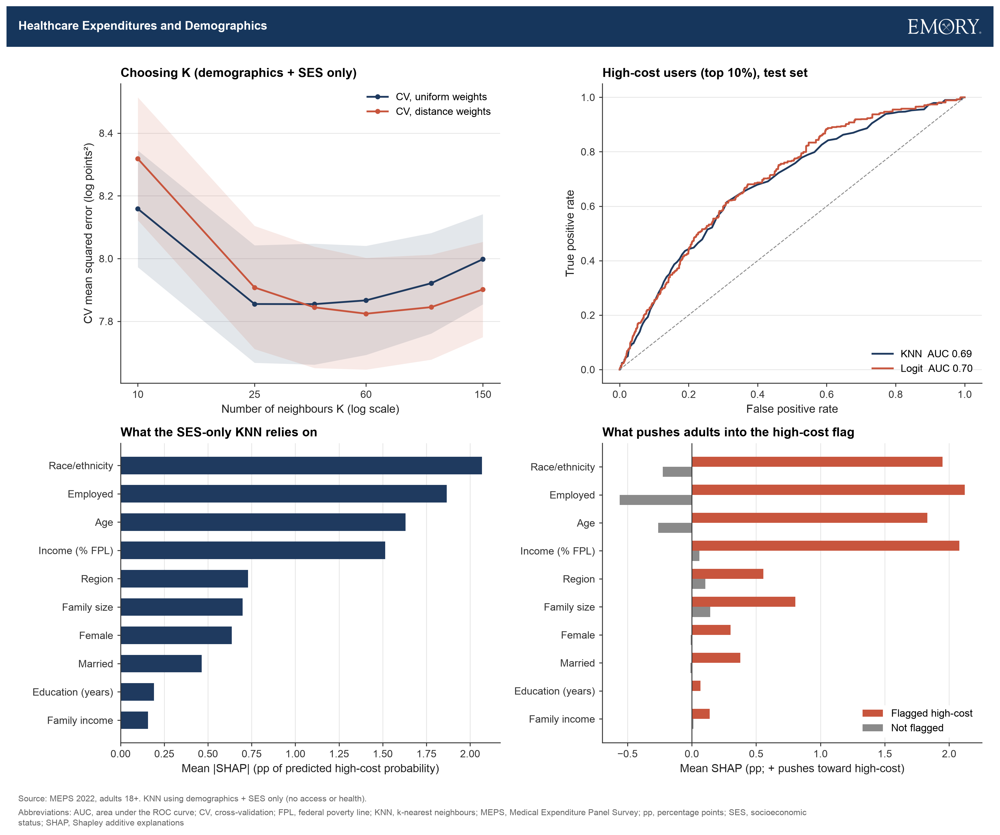

# Who Spends on Health Care? Demographics, Access, and Machine Learning in MEPS 2022

**An ML research portfolio on how demographic and socioeconomic factors relate to U.S. healthcare expenditures.** It uses the 2022 Medical Expenditure Panel Survey (17,387 adults, survey-weighted) and draws on unsupervised learning, supervised prediction, explainable AI (SHAP), and double machine learning (DML).

> Course project, ECON 442 (Machine Learning for Economics), Emory University, Fall 2026.
> All results are cross-sectional **associations, not causal effects**.



---

## Research questions

1. How does annual healthcare spending (total and out-of-pocket) vary by age, sex, race/ethnicity, income, education and family composition **after holding health status constant**?
2. Do racial/ethnic gaps in spending and in out-of-pocket **financial burden** vary by income, age and sex?
3. How well can demographics and socioeconomic status (SES) **predict** spending, and how much do access to care and health add?
4. Which natural population **profiles** emerge, and how do their spending and burden differ?

## Data

| | |
|---|---|
| Source | AHRQ **MEPS Household Component, 2022 Full-Year Consolidated File (HC-243)** |
| Sample | Adults 18+ with a positive person weight: **17,387** |
| Outcomes | Total spending (`TOTEXP22`), out-of-pocket (`TOTSLF22`), any spending, top-10% high-cost user, family out-of-pocket burden (>10% of family income) |
| Design | Person weights (`PERWT22F`), strata (`VARSTR`) and PSUs (`VARPSU`) are used in every estimate. SEs are design-based or clustered on strata × PSU. |
| Health controls | Self-rated physical and mental health, plus six diagnosed conditions (diabetes, hypertension, heart disease, asthma, arthritis, cancer) |

The raw file is public. Download `h243dta.zip` from [meps.ahrq.gov](https://meps.ahrq.gov/mepsweb/data_stats/download_data_files_detail.jsp?cboPufNumber=HC-243) into `data/`, then run `code/01_prepare_data.py`.

---

## Key findings


| Finding | Result |
|---|---|
| Spending is highly concentrated | The top 5% of adults account for **47%** of spending (AHRQ reports 48–51%) |
| Most of the age gradient is health | Unadjusted, adults 65+ spend 3× what adults 18–34 do. After adjusting for health, the difference is about 1.2× ($8.5k vs $7.2k) |
| Race gaps persist after full adjustment | Holding health, SES and access fixed, spending vs NH White adults is **−52%** for NH Black, **−54%** for Hispanic and **−37%** for NH Asian adults |
| Low-income White adults face more cost strain | Among adults below 200% of the federal poverty line, **25%** of White adults vs **12%** of Black and Hispanic adults are in families paying more than 10% of income out of pocket (health-adjusted) |
| Race gaps shrink after 65 | The Black–White gap is **−66%** at ages 18–34 and **−32%** at 65+, and the Hispanic gap goes from −64% to −13% (age × race interaction p < 0.001). Income and insurance do not change the gap (p = 0.20, 0.29). |
| Access predicts like illness | Having a usual source of care is the **#2 SHAP predictor**, and being uninsured lowers predicted spending the most |
| Demographics + SES get ~60% of the way | Test R² is **0.24** with demographics and SES only vs **0.39** with access and health added, consistent across 9 models |
| Flexible ML adds little | Gradient boosting reaches R² 0.391 vs 0.372 for OLS, matching prior work (Buntin & Zaslavsky 2004; Rose 2016) |

---

## Figures

### Who spends more?
| | |
|---|---|
|  |  |
| **Fig 2.** Health-adjusted mean spending by group (bars) vs unadjusted means (diamonds) | **Fig 3.** Share of explained variance by domain: LMG (linear) vs SHAP (XGBoost) |


**Fig 4.** Adjusted % differences in total spending from a single survey-weighted model that includes every factor at once.

### Race, income and out-of-pocket burden
| | |
|---|---|
|  |  |
| **Fig 5.** Who pays more vs who is strained, by race and income (health-adjusted) | **Fig 6.** Race gaps as controls are added |


**Fig 7.** Race × age and race × sex interactions. Gaps narrow sharply at Medicare age.

### Unsupervised learning: population profiles
| | |
|---|---|
|  |  |
| **Fig 8.** Seven K-means profiles shown in PCA, t-SNE and UMAP space | **Fig 9.** Spending by profile |

### Prediction and explainability
| | |
|---|---|
|  |  |
| **Fig 10.** Demographics + SES alone vs full model, across 9 learners | **Fig 13.** SHAP beeswarm for XGBoost (each dot is one adult) |
|  |  |
| **Fig 11.** Cross-validated KNN: choice of K, high-cost ROC and SHAP drivers | **Fig 12.** The same analysis with demographics and SES only |

---

## Methods

| Block | Methods | Script |
|---|---|---|
| Descriptives | Survey-weighted means with Taylor-linearized SEs; health-adjusted predictive margins | `02_descriptives.py`, `margins.py` |
| Unsupervised | PCA; K-means (elbow + silhouette, K = 7) checked against a Gaussian mixture and Ward clustering (ARI); t-SNE and UMAP | `03_unsupervised.py` |
| Supervised | OLS, LASSO, Ridge, Elastic Net, KNN, random forest, gradient boosting, XGBoost, MLP; 80/20 split with 5-fold CV tuning; two-part (hurdle) model with Duan smearing; high-cost classifier | `04_supervised.py`, `06_knn.py`, `13_pred_ses_vs_full.py` |
| Explainability | TreeSHAP, permutation SHAP (KNN), SHAP interaction values, LMG R² decomposition, permutation importance | `09_shap_main.py`, `12_drivers.py`, `14_interactions.py` |
| Inference | Survey-weighted WLS with strata × PSU clustered SEs; nested models; race × moderator interactions with joint Wald tests | `08_focused_oop.py`, `12_drivers.py`, `14_interactions.py` |
| Double ML | Partially linear model with 5-fold cross-fitting, repeated; LASSO, RF, XGBoost and neural-net nuisance learners; heterogeneity by age | `05_inference.py`, `16_dml_extensions.py` |
| Loss hyperparameter | \|y − x′θ\|^a chosen by CV (a = 1 LAD/median, a = 2 OLS/mean) | `15_loss_hyperparameter.py` |

A literature comparison, with verified citations, is in [`output/literature_review.md`](output/literature_review.md).

## Reproduce

```bash
pip install numpy pandas scipy scikit-learn==1.6.1 xgboost statsmodels matplotlib shap umap-learn patsy pyarrow
# put h243.dta in data/, then from this folder:
python code/01_prepare_data.py
for s in 02_descriptives 03_unsupervised 04_supervised 05_inference 06_knn 08_focused_oop 09_shap_main \
         12_drivers 13_pred_ses_vs_full 13b_plot_pred 14_interactions 14b_plot_interactions 00_schematic 10_key_findings; do
  python code/$s.py
done
python code/99_main_figures.py   # collects the numbered main figures into output/main_figures/
```
`03_unsupervised.py` takes the profile names as a JSON argument (see the script header). DML and the SHAP or interaction scripts are compute-heavy, so a multi-core machine is recommended.

## Repository layout
```
code/                 analysis scripts (numbered in run order) + style.py (figure theme) + margins.py
data/                 cleaned analysis file (raw MEPS file not included; see Data)
output/main_figures/  the numbered main figures
output/figures/       all figures (supplementary/ holds the rest)
output/tables/        every estimate behind the figures (CSV)
```

## Caveats
- The data are cross-sectional, so all estimates are conditional associations. Race is not a manipulable treatment, and DML estimates are interpreted descriptively.
- Health controls are coarse: there are no measures of disability or condition severity.
- Spending is self-reported and imputed by AHRQ, and outcomes are modeled as log(1 + $).
