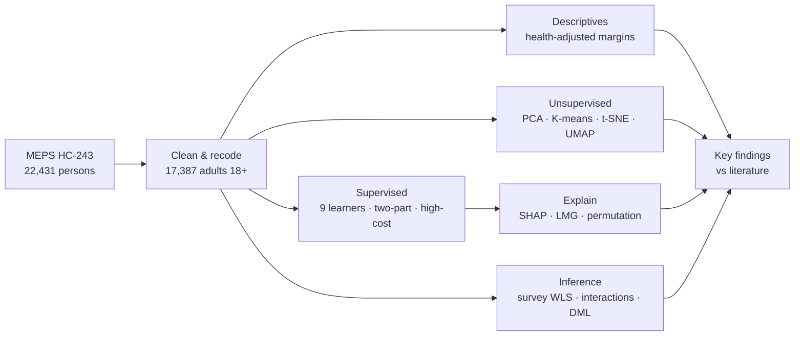
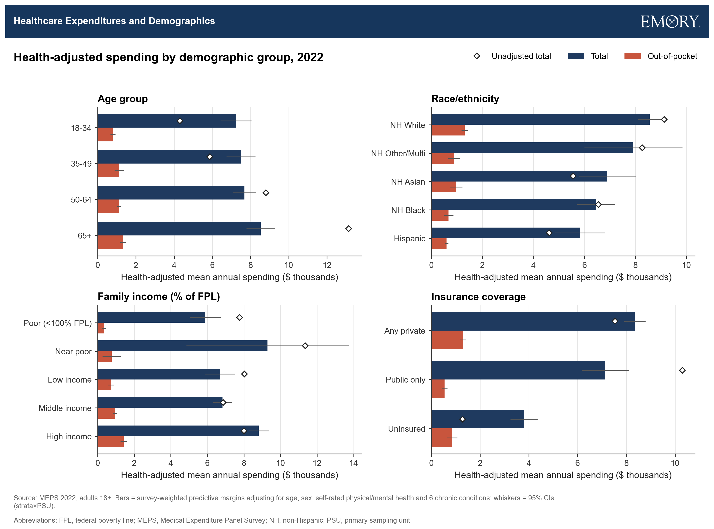
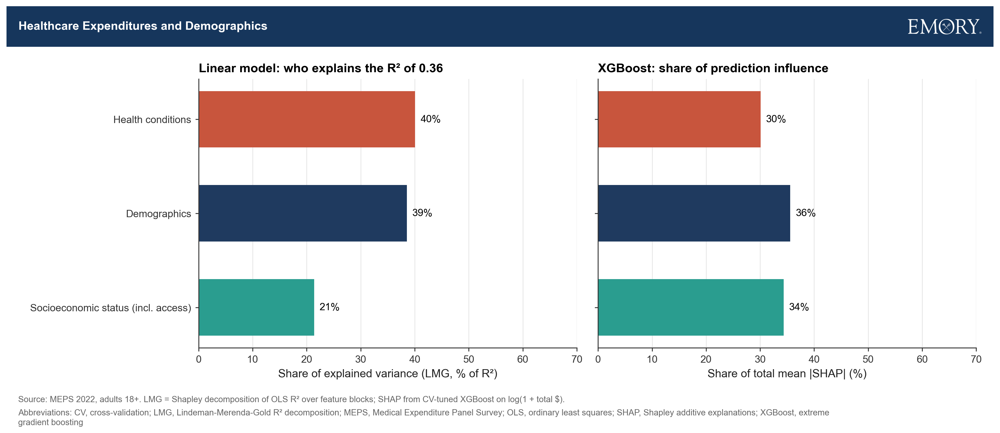
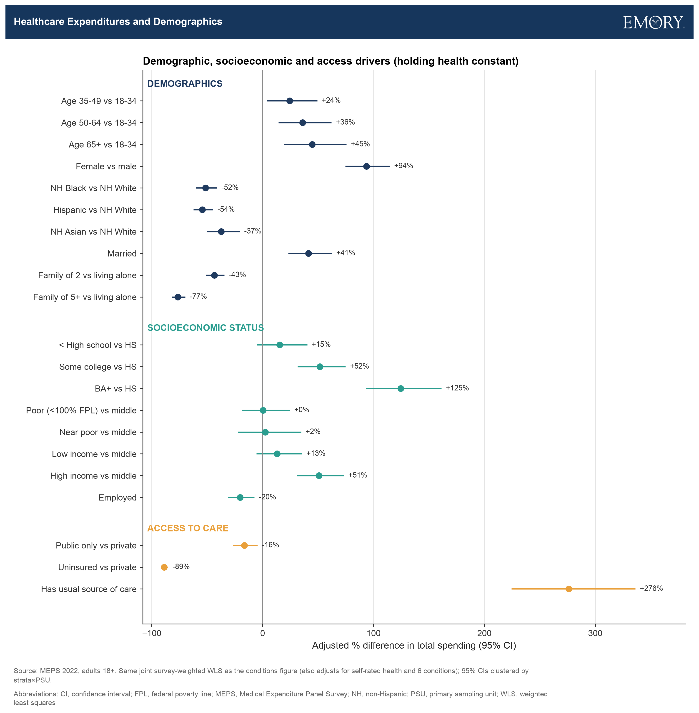
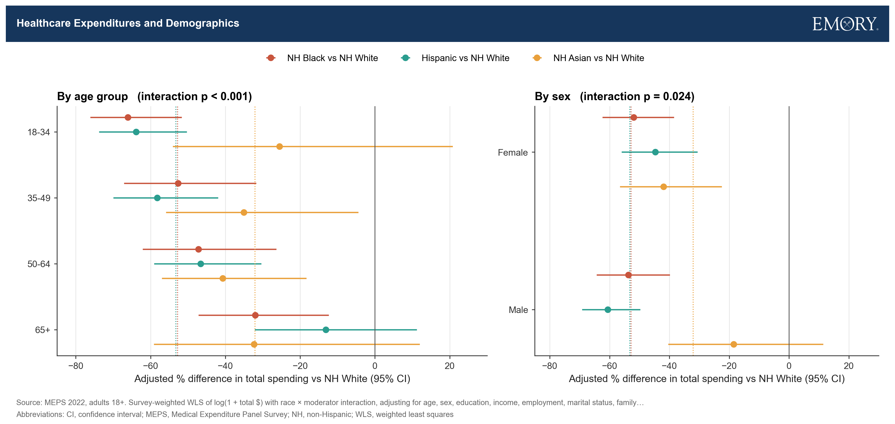
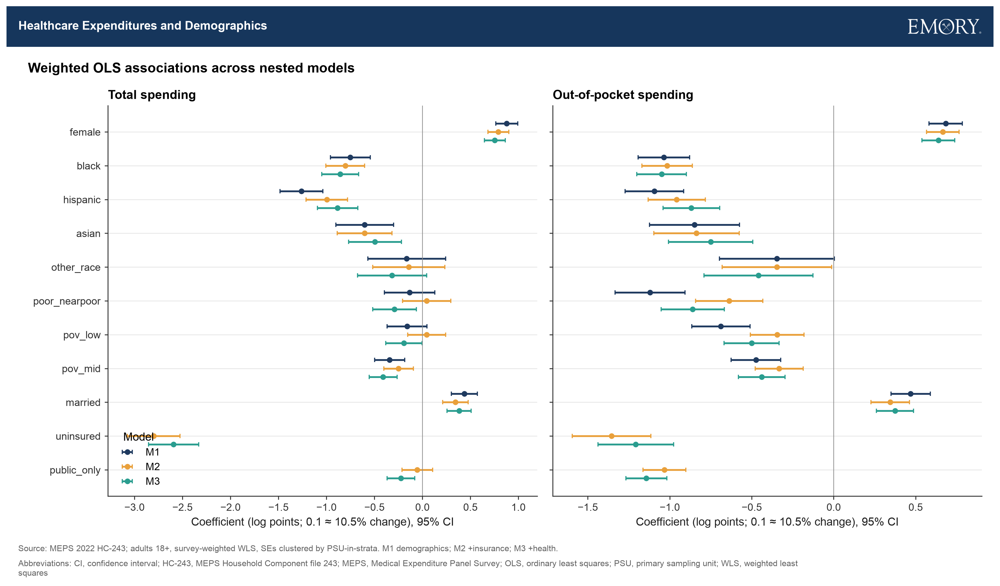

<div align="center">

# Who Spends on Health Care?
### Demographics, Access, and Machine Learning in MEPS 2022

**How do age, sex, race, income and access to care relate to what U.S. adults spend on health care — once health itself is held fixed?**


-012169)


**Eshan Momin · Zach Etizioni · Amulya Arora**

*ECON 442 · Machine Learning for Economics · Emory University · Fall 2026*

</div>

---

## 📌 Results at a glance

<table>
<tr>
<td align="center" width="25%"><h2>$7,762</h2>mean annual spending<br/>per adult (2022)</td>
<td align="center" width="25%"><h2>47%</h2>of all spending comes<br/>from the top 5% of adults</td>
<td align="center" width="25%"><h2>−52%</h2>Black–White spending gap,<br/>fully adjusted</td>
<td align="center" width="25%"><h2>R² 0.39</h2>best test fit (gradient boosting);<br/>OLS gets 0.37</td>
</tr>
</table>


| # | Finding | Evidence |
|:-:|---|---|
| 1 | **Spending is extremely concentrated** | Top 5% → **47%** of spending (AHRQ benchmark: 48–51%) |
| 2 | **The age gradient is mostly health** | 65+ vs 18–34: **3.0×** unadjusted → **1.2×** health-adjusted ($8.5k vs $7.2k) |
| 3 | **Race gaps survive full adjustment** | vs NH White, holding health, SES & access fixed: NH Black **−52%**, Hispanic **−54%**, NH Asian **−37%** |
| 4 | **Low spending ≠ low strain** | Below 200% FPL, **25%** of White vs **12%** of Black/Hispanic adults face OOP burden >10% of income |
| 5 | **Medicare narrows the gaps** | Black–White gap **−66%** (18–34) → **−32%** (65+); age × race p < 0.001, while income and insurance moderators are n.s. |
| 6 | **Access predicts like illness** | Usual source of care is the **#2 SHAP feature**; being uninsured has the largest negative effect |
| 7 | **Demographics + SES get ~60% of the way** | Test R² **0.24** (demographics + SES) vs **0.39** (+ access & health), consistent across 9 learners |
| 8 | **Flexible ML adds little over OLS** | 0.391 (GBM) vs 0.372 (OLS), matching Buntin & Zaslavsky (2004) and Rose (2016) |

> ⚠️ Cross-sectional data: every estimate is a **conditional association, not a causal effect**.

---

## 🧭 The pipeline




### ① Data & sample
| | |
|---|---|
| **Source** | AHRQ **MEPS Household Component, 2022 Full-Year Consolidated File (HC-243)** |
| **Sample** | Adults 18+ with a positive person weight — **17,387** |
| **Outcomes** | Total spending (`TOTEXP22`), out-of-pocket (`TOTSLF22`), any spending, top-10% high-cost user, family OOP burden > 10% of income |
| **Survey design** | Person weights (`PERWT22F`), strata (`VARSTR`), PSUs (`VARPSU`) in every estimate |
| **Health controls** | Self-rated physical & mental health + six diagnoses (diabetes, hypertension, heart disease, asthma, arthritis, cancer) |


### ② Descriptives: who spends more?
<table><tr>
<td width="50%"><br/><sub><b>Fig 2. Most of the "older people spend more" story is really about health.</b> Unadjusted, adults 65+ spend about 3× what adults 18–34 do. After holding health constant (bars), the difference falls to about 1.2× ($8.5k vs $7.2k). Race gaps barely move after this adjustment.</sub></td>
<td width="50%"><br/><sub><b>Fig 3. Health explains the most, but insurance is next.</b> In the linear (LMG) decomposition, health accounts for 40% of explained variance, insurance 16%, age 13%, family 12% and race 9%. Income adds only 2% once the other factors are in the model. SHAP from XGBoost gives a similar ranking.</sub></td>
</tr></table>


<sub><b>Fig 4. Race gaps remain even when everything is in the model.</b> With health, SES and access held fixed, NH Black adults spend 52%, Hispanic adults 54% and NH Asian adults 37% less than NH White adults. Adults 65+ spend 45% more than adults 18–34, and the Midwest and West spend about 20–25% more than the South.</sub>

### ③ Race, income and out-of-pocket burden
<table><tr>
<td width="50%"><br/><sub><b>Fig 5. Spending less is not the same as being under less financial strain.</b> Among low-income adults (below 200% FPL), 25% of White adults are in families paying more than 10% of income out of pocket, compared with 12% of Black and Hispanic adults (health-adjusted).</sub></td>
<td width="50%"><br/><sub><b>Fig 6. Controls shrink the out-of-pocket race gaps but do not close them.</b> Adding age, sex, income, insurance and health in turn shrinks the Hispanic–White gap from −2.09 to −1.13 log points and the Black–White gap from −1.57 to −1.12. Both remain highly significant.</sub></td>
</tr></table>


<sub><b>Fig 7. Race gaps get much smaller at Medicare age.</b> The Black–White spending gap is −66% at ages 18–34 and −32% at 65+. The Hispanic–White gap goes from −64% to −13% (age × race interaction p < 0.001). Income and insurance do not significantly change the gaps (p = 0.20 and 0.29).</sub>

### ④ Unsupervised learning: population profiles
<table><tr>
<td width="55%"><br/><sub><b>Fig 8. The sample falls into seven distinct profiles.</b> K-means finds groups such as older chronically ill adults, healthy affluent White workers and young, often uninsured Hispanic adults. The groups separate clearly in PCA, t-SNE and UMAP, and Gaussian-mixture and Ward clustering give similar groups.</sub></td>
<td width="45%"><br/><sub><b>Fig 9. Spending varies more than fivefold across profiles.</b> Mean spending ranges from $2.9k to $16.5k per person. Older chronically ill adults spend the most. Young, often uninsured Hispanic adults spend the least, about 92% less than the reference profile.</sub></td>
</tr></table>

### ⑤ Supervised prediction

<sub><b>Fig 10. Demographics and SES alone get about 60% of the way.</b> In every one of the 9 learners, test R² is about 0.22–0.24 with demographics and SES only and about 0.37–0.39 once access and health are added. Who someone is predicts spending moderately well; how sick they are and whether they have access to care add the rest.</sub>

| Model | Test R² (log $) | | Model | Test R² (log $) |
|---|:-:|---|---|:-:|
| Gradient boosting | **0.391** | | OLS | 0.372 |
| XGBoost | 0.390 | | Ridge | 0.372 |
| Random forest | 0.386 | | LASSO | 0.371 |
| MLP | 0.378 | | Elastic Net | 0.371 |

<sub>Flexible ML models beat OLS by only about 0.02 R², consistent with earlier health-spending research.</sub>

<table><tr>
<td width="50%"><br/><sub><b>Fig 11. KNN does about as well as OLS.</b> Cross-validation selects K = 60 (distance-weighted), with test R² 0.35 vs 0.37 for OLS. Chronic conditions and access drive its high-cost predictions.</sub></td>
<td width="50%"><br/><sub><b>Fig 12. Without health information, race, employment and age drive the predictions.</b> When KNN sees only demographics and SES, race/ethnicity, employment, age and income (% FPL) are the main features behind high-cost predictions.</sub></td>
</tr></table>

### ⑥ Explainability

<sub><b>Fig 13. Access to care predicts spending about as strongly as illness does.</b> The number of chronic conditions is the top predictor, and having a usual source of care is a close second. Larger families predict lower spending per person. Being uninsured pushes predicted spending down the most.</sub>

### ⑦ Inference: Double ML
Double ML re-estimates the key associations while letting flexible ML models (LASSO, random forest, XGBoost, neural net) absorb the control variables. It uses a partially linear model with repeated 5-fold cross-fitting, and it also tests whether effects differ by age.

<details>
<summary><b>📂 Supplementary figures</b> (click to expand)</summary>

| | |
|---|---|
|  |  |
| Spending distribution | Model comparison |
|  |  |
| K-means selection | PCA biplot |
|  |  |
| High-cost ROC | LASSO path |
|  |  |
| SHAP dependence: age | SHAP dependence: family income |
|  |  |
| SHAP interaction pairs | OLS coefficients |

</details>

---

## 🧪 Methods summary

| Block | Methods |
|---|---|
| Descriptives | Survey-weighted means, Taylor-linearized SEs, health-adjusted predictive margins |
| Unsupervised | PCA; K-means (elbow + silhouette, K = 7) vs GMM & Ward (ARI); t-SNE, UMAP |
| Supervised | OLS, LASSO, Ridge, Elastic Net, KNN, RF, GBM, XGBoost, MLP; 80/20 split, 5-fold CV; two-part hurdle with Duan smearing; high-cost classifier |
| Explainability | TreeSHAP, permutation SHAP (KNN), SHAP interactions, LMG R² decomposition, permutation importance |
| Inference | Survey WLS with strata × PSU clustered SEs; nested models; race × moderator Wald tests |
| Double ML | Partially linear model, repeated cross-fitting, 4 nuisance learners |
| Loss tuning | \|y − x′θ\|<sup>a</sup> with a chosen by CV (a = 1 LAD ↔ a = 2 OLS) |

Literature comparison with verified citations: [`output/literature_review.md`](output/literature_review.md)

## ▶️ Reproduce

```bash
pip install -r requirements.txt
# data/h243.dta is included (also data/h243.zip); or download HC-243 from meps.ahrq.gov
python code/01_prepare_data.py
for s in 02_descriptives 03_unsupervised 04_supervised 05_inference 06_knn 08_focused_oop 09_shap_main \
         12_drivers 13_pred_ses_vs_full 13b_plot_pred 14_interactions 14b_plot_interactions 00_schematic 10_key_findings; do
  python code/$s.py
done
python code/99_main_figures.py   # collects numbered main figures into output/main_figures/
```
`03_unsupervised.py` takes profile names as a JSON argument (see its header). DML and SHAP-interaction scripts are compute-heavy.

## 🗂 Repository layout
```
code/                 analysis scripts, numbered in run order
  ├─ style.py         shared figure theme
  └─ margins.py       survey-weighted predictive margins
data/                 MEPS HC-243 raw file + cleaned analysis CSV
output/
  ├─ main_figures/    numbered figures used above
  ├─ figures/         supplementary figures
  ├─ tables/          every estimate behind the figures (CSV)
  └─ literature_review.md
```

## ⚠️ Caveats
- Cross-sectional data → conditional associations only. Race is not a manipulable treatment; DML estimates are read descriptively.
- Health controls are coarse (no disability or severity measures).
- Spending is self-reported and AHRQ-imputed; outcomes are modeled as log(1 + $).
